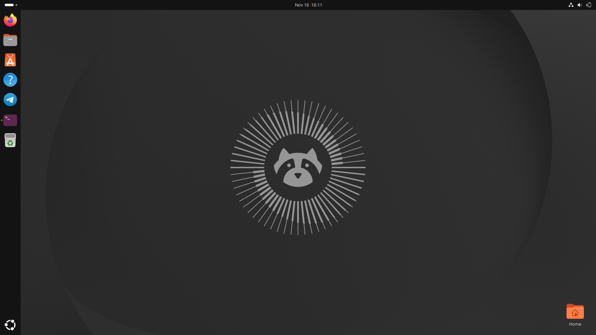
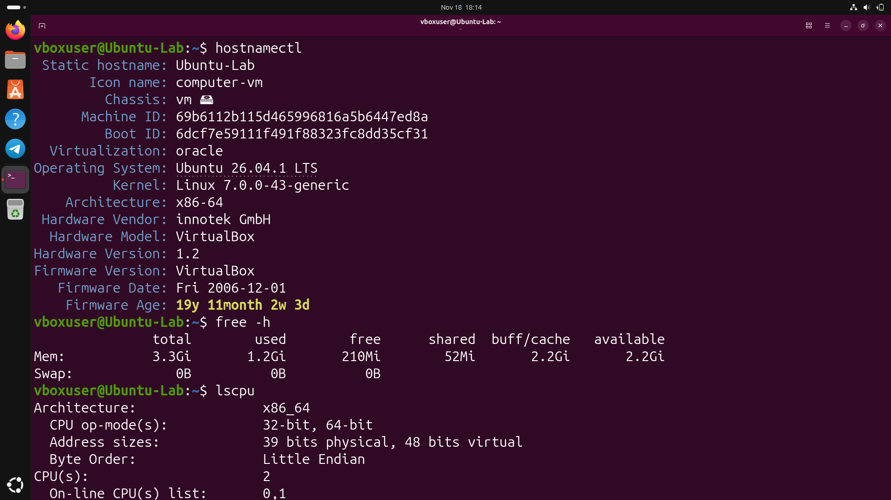
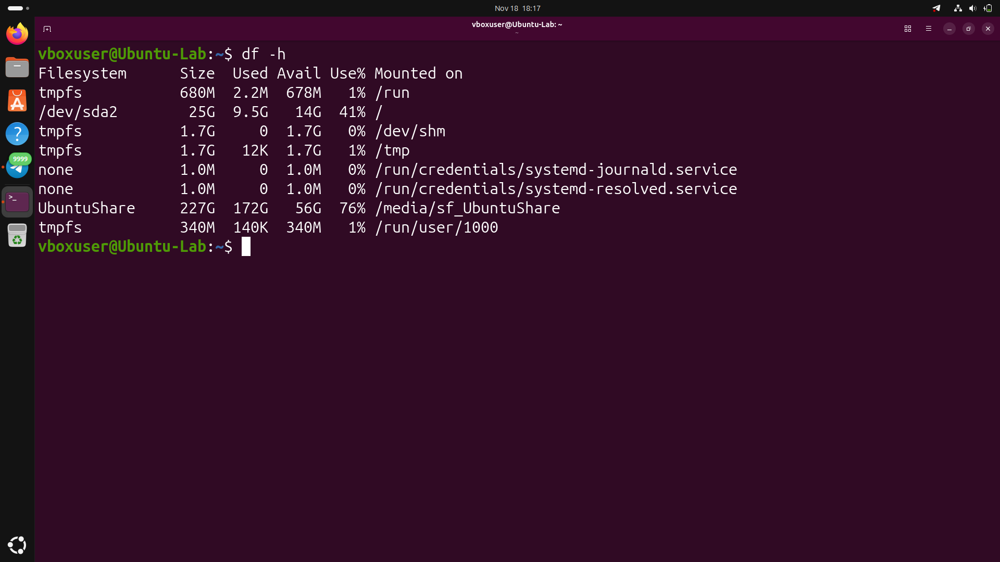
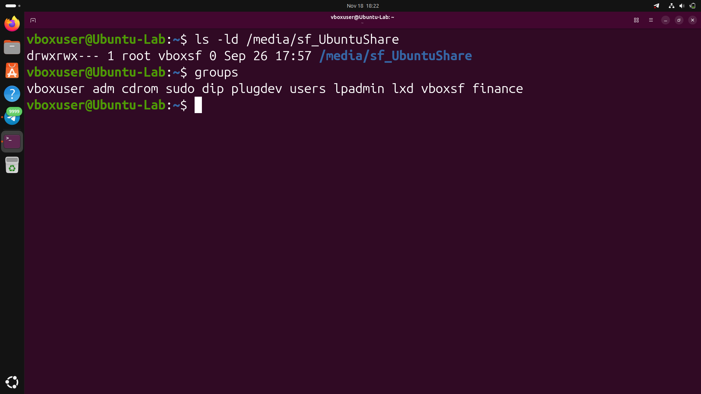

# Ubuntu VM Setup Portfolio

## 1. Project Overview

This project demonstrates my hands-on experience setting up and inspecting an Ubuntu Linux Virtual Machine using Oracle VirtualBox.

The goal of this project is to practice basic Linux system administration and understand the virtual machine environment.

## 2. Environment

- **Operating System:** Ubuntu 26.04.1 LTS
- **Virtualization Platform:** Oracle VirtualBox
- **Architecture:** x86_64

## 3. Tasks Completed

- Checked operating system information using `hostnamectl`
- Inspected memory usage using `free -h`
- Checked CPU information using `lscpu`
- Identified the virtualization environment using `systemd-detect-virt`
- Checked disk usage using `df -h`
- Inspected shared folder permissions
- Verified user group membership

## 4. Project Screenshots

### Ubuntu Desktop

### System Resource Information

### Disk Storage

### Shared Folder Permissions

## 5. Project Purpose

This project demonstrates practical beginner-level experience with Ubuntu Linux, VirtualBox, system information commands, storage inspection, and basic permission management.

## 6. Notes

Shared folder write access has not been tested as part of this project.
